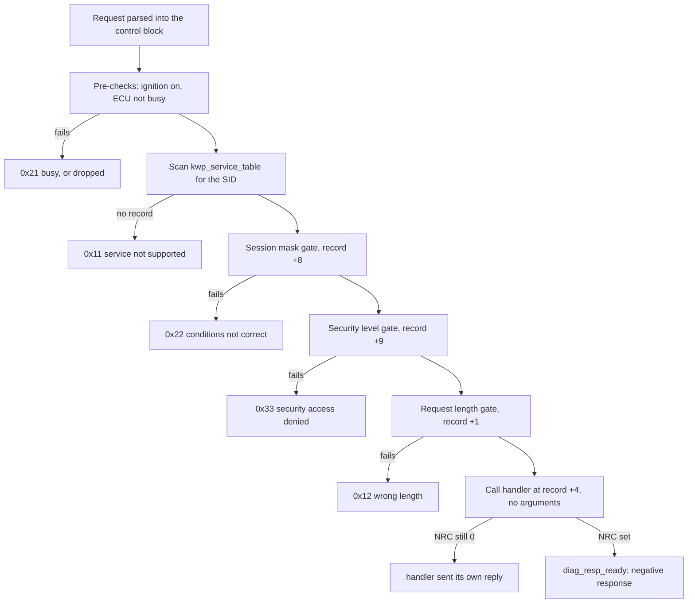
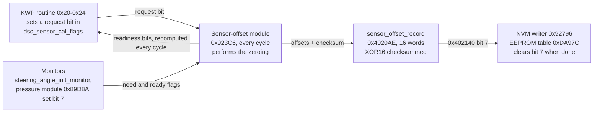
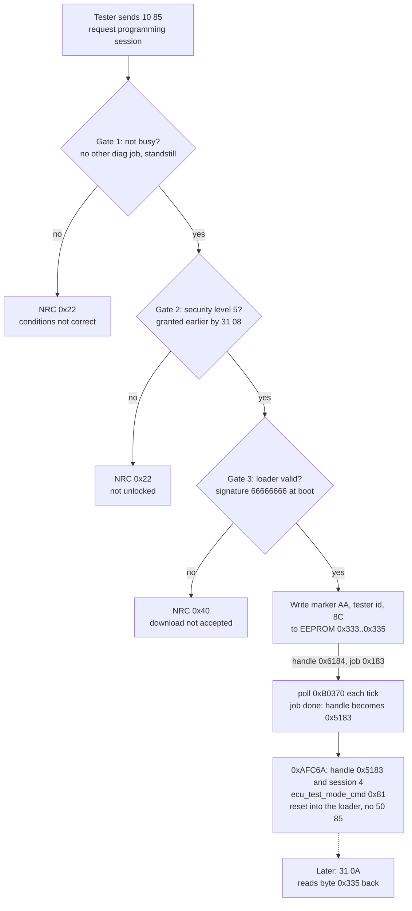

# kwp_dispatch Analysis

As of 2026-11-12. Analysis notes for the MK60-M-Core-Disassembly-Process repository.

## Summary

`kwp_dispatch` at 0xB10C4 is the KWP2000 service dispatcher of the MK60E5 DSC firmware: it looks a request's service ID up in a 23-record table, applies a session, a security and a request-length gate, and calls the per-service handler with no arguments. The handlers read a global KWP control block instead of parameters, which is why every prototype in the listing is misleading.

The gates are the whole access-control story. Only three services require a security level: WriteDataByLocalIdentifier (0x3B) at level 2, the proprietary service 0x09 at level 4, and WriteMemoryByAddress (0x3D) at level 0x7F. One hard-coded exception lets 0x3B with request byte 0x90 through without any session or security check. The ignition flag, `power_flags` bit 6, switches the whole dispatcher: with the ignition off only routine 0x05 is answered, and with it on that routine is the one request always refused.

RoutineControl (0x31) is the largest handler and the door to the service-mode procedures a dealer tool triggers: five sensor zero-point calibrations, the RPA flat-tyre-monitor reset, the two valve calibrations, a coding write, the CCP arm toggle, and an MD5 seed-key (routine 0x08) that grants security level 5, the level the 10 85 reflash session requires. The sensor calibrations run through a shared request-and-readiness flag byte and a checksummed, EEPROM-backed offset record; that mechanism is traced in full below.

## Context

KWP2000 (ISO 14230-3) is the request-and-response diagnostic protocol BMW tools speak to the DSC over K-line or DCAN. A request is a service ID (SID) followed by service-specific bytes; the ECU answers positively with SID + 0x40, or negatively with 0x7F, the SID and a negative response code (NRC).

By the time `kwp_dispatch` runs, a lower layer (`kwp_parse_request` at 0xB3524, fed by the serial and CAN receive drivers) has copied the request into a global control block in RAM. The handlers read that block directly, so the six register parameters the auto-analysis assigned to every handler carry nothing.

| Symbol | Address | Role |
| --- | --- | --- |
| `kwp_req_buf` | 0x409489 | request bytes as received; byte 0 is the SID |
| `kwp_sid` | 0x409533 | service ID of the current request |
| `kwp_subfn` | 0x409534 | the byte after the SID: for 0x31 the routine ID, for the length gate the request length |
| `kwp_session` | 0x409544 | current session state byte, tested against each record's session mask |
| `kwp_seclevel` | 0x409545 | security level granted by SecurityAccess (0x27) |
| NRC byte | 0x409538 | pending negative response code; 0 = none, 0xFF = send nothing |
| `diag_resp_ready` | 0x409490 region | set when a negative response must go out |
| `kwp_service_table` | 0xF30A0 | the 23-record service table in flash |
| `power_flags` bit 6 | 0x400956 | debounced ignition-on: `power_state_update` sets it when its state machine enters the on state from `terminal_state` 4 or 5 or the hardware ignition input (0x400958 bit 5), and clears it when the input drops and the 7-count timer runs out |
| KWP lock flag | 0x409509 bit 7 | makes the busy helper refuse with 0x21; read and cleared through module method 0, cleared by the KWP main cycle at 0xB00F4 |
| deferred-reply wait handle | 0x409436 (16-bit) | non-zero while a handler waits for an EEPROM job; below 0x1000 it is the job's record id plus one, and the KWP cycle at 0xB0430 polls that job every tick and sends the reply when it completes |
| deferred-reply layout | 0x4094D5 | offset at which the completion routine (0xB03CC) copies the reply data into the response |
| KWP scratch buffer | 0x40943E | destination of every EEPROM read the KWP services queue |

The dispatcher itself is reached from the KWP state machine at 0xB067C and is listed in the firmware's own function-pointer tables, which is how the recovery found it. The names above come from the cmg5461 symbol map carried over by the reference project; the addresses are from the 7846816A (E9x M3) image.

## Dispatcher flow

The dispatcher is a straight chain of checks; the first that fails sets the negative response code and skips the rest.

SID 0x3B with request byte 0x90 skips the session and security gates. NRC 0xFF means answer nothing.

In order:

1. **Pre-checks.** With the ignition on (`power_flags` bit 6 set), the busy helper at 0xAF932 is consulted; it reports busy when any wheel's raw speed is above 40000 or the KWP lock flag is set, and then every SID except 0x3E TesterPresent is answered 0x21 busyRepeatRequest. Still with the ignition on, RoutineControl 0x31 with routine ID 0x05 is always refused with 0x12. With the ignition off, every request is dropped without an answer (internal code 0xFF) except that same routine 0x05, which goes on through the normal gates and handler.
2. **Table scan.** A linear scan of the 23 records of `kwp_service_table`, comparing each record's first byte with `kwp_sid`. No match gives 0x11 serviceNotSupported.
3. **Session gate.** The current session-state byte ANDed with the record's mask at offset 8 must be non-zero, else 0x22 conditionsNotCorrect.
4. **Security gate.** When bit 7 of the session-state word is set and `kwp_seclevel` is below the record's level at offset 9, 0x33 securityAccessDenied.
5. **Length gate.** The byte after the SID must equal the record's byte at offset 1 unless that byte is 0xFF, else 0x12. The reference comment calls this the sub-function check; the table values read as fixed request lengths (2 for ReadEcuIdentification, 3 for ReadDataByCommonIdentifier with a 2-byte DID, 6 for ReadMemoryByAddress).
6. **Bypass.** SID 0x3B WriteDataByLocalIdentifier with request byte 0x90 skips gates 3 and 4.
7. **Handler call.** The function pointer at record offset 4, bit 0 masked off, is called with no arguments.
8. **Response.** If the handler left the NRC byte at zero it has already built its positive response and the dispatcher clears the request state. Any other value except 0xFF sets `diag_resp_ready` so the negative response is sent.

## The service table

`kwp_service_table` at 0xF30A0 holds 23 records of 12 bytes. The dispatcher reads four fields; the rest is zero in every record.

| Offset | Size | Field | Used by |
| --- | --- | --- | --- |
| +0 | 1 | service ID | table scan |
| +1 | 1 | expected request length, 0xFF = any | length gate (NRC 0x12) |
| +4 | 4 | handler address; bit 0 is the M·CORE alternate-register-file flag, masked before the call | handler call |
| +8 | 1 | session mask, ANDed with the session-state byte | session gate (NRC 0x22) |
| +9 | 1 | minimum security level | security gate (NRC 0x33) |

The records as they stand in the 7846816A image, in table order:

| # | SID | Service (ISO 14230-3) | Handler | Length | Session mask | Security |
| --- | --- | --- | --- | --- | --- | --- |
| 0 | 0x14 | ClearDiagnosticInformation | `kwp_14_clrdiag` | 3 | 0x90 | 0 |
| 1 | 0x10 | StartDiagnosticSession | `kwp_10_start_session` | any | 0x94 | 0 |
| 2 | 0x20 | StopDiagnosticSession | `kwp_20_stop_session` | 1 | 0x10 | 0 |
| 3 | 0x18 | ReadDTCByStatus | `kwp_18_routine_ffxx` | 4 | 0x90 | 0 |
| 4 | 0x17 | ReadStatusOfDTC | `kwp_17_dtc_status` | 3 | 0x90 | 0 |
| 5 | 0x1A | ReadEcuIdentification | `kwp_1a_read_ecu_id` | 2 | 0x90 | 0 |
| 6 | 0x21 | ReadDataByLocalIdentifier | `kwp_21_rd_local_id` | 2 | 0x94 | 0 |
| 7 | 0x27 | SecurityAccess | `kwp_27_security_access` | any | 0x14 | 0 |
| 8 | 0x30 | InputOutputControlByLocalIdentifier | `kwp_30_io_ctl` | any | 0x10 | 0 |
| 9 | 0x31 | StartRoutineByLocalIdentifier | `kwp_31_routine_ctl` | any | 0x94 | 0 |
| 10 | 0x3B | WriteDataByLocalIdentifier | `kwp_3b_wr_local_id` | any | 0x10 | 2 |
| 11 | 0x22 | ReadDataByCommonIdentifier | `kwp_22_rd_common_id` | 3 | 0x94 | 0 |
| 12 | 0x2E | WriteDataByCommonIdentifier | `kwp_2e_wr_common_id` | any | 0x94 | 0 |
| 13 | 0x3E | TesterPresent | `kwp_3e_tester_present` | any | 0x94 | 0 |
| 14 | 0x33 | RequestRoutineResultsByLocalIdentifier | `kwp_33_routine_results` | 2 | 0x10 | 0 |
| 15 | 0x29 | EnableNormalMessageTransmission | `kwp_29_enable_normal_msg` | any | 0x94 | 0 |
| 16 | 0x28 | DisableNormalMessageTransmission | `kwp_28_disable_normal_msg` | any | 0x94 | 0 |
| 17 | 0x81 | StartCommunication | `kwp_81_start_comm` | 1 | 0x94 | 0 |
| 18 | 0x82 | StopCommunication | `kwp_82_stop_comm` | 1 | 0x94 | 0 |
| 19 | 0x11 | EcuReset | `kwp_11_ecu_reset` | 2 | 0x94 | 0 |
| 20 | 0x09 | proprietary | `kwp_09_proprietary` | 7 | 0x10 | 4 |
| 21 | 0x23 | ReadMemoryByAddress | `kwp_23_rd_memory` | 6 | 0x94 | 0 |
| 22 | 0x3D | WriteMemoryByAddress | `kwp_3d_wr_memory` | 7 | 0x10 | 0x7F |

Three session-mask values occur: 0x10, 0x90 and 0x94 (bits 4, 7 and 2). Bit 4 is in every mask, so it is the state in which all services are reachable, most likely the extended diagnostic session; 0x90 and 0x94 also admit the states behind bits 7 and 2. The six services allowed in 0x10 only are the ones that change the ECU or control actuators: StopSession, IoControl, RoutineResults, WriteLocalId, the proprietary 0x09 and WriteMemory. The handler names are from the cmg5461 symbol map; `kwp_18_routine_ffxx` is that map's name for the ReadDTCByStatus slot and was kept as found.

TesterPresent (0x3E) is the one handler small enough to describe in a line: a 28-byte leaf at 0xB1224 with no frame. A bare request (length 1) is always answered positively. With the ISO responseRequired byte, 0x01 is answered, 0x02 is accepted silently with no reply, and any other value gives 0x12. It reads the request length at 0x409537, the parameter at 0x409534, and raises `diag_resp_ready` at 0x409435. The dispatcher also exempts it from the busy check, so a tester can keep a session alive while the ECU refuses everything else with 0x21. In our project this handler is a label, not a function, because it has no prologue: the same recovery gap as the pointer-called helpers.

## Negative response codes

The dispatcher writes the code into the byte at 0x409538; handlers write the same byte. A tester sees it as the third byte of a `7F <SID> <NRC>` reply.

| Code | ISO name | Produced by |
| --- | --- | --- |
| 0x11 | serviceNotSupported | no table record for the SID |
| 0x12 | subFunctionNotSupported | request length differs from the record's byte +1; inside 0x31, an unknown routine ID or a routine refused by coding; always for routine 5 while the ignition is on |
| 0x21 | busyRepeatRequest | the busy helper at 0xAF932 with the ignition on: any wheel raw speed above 40000, or the KWP lock flag 0x409509 bit 7; inside 0x31, a routine whose start function reported failure |
| 0x22 | conditionsNotCorrect | session mask gate; inside 0x31, a calibration whose readiness bit is clear, or routines 5/7/8/0xA in session 0x80 without module approval |
| 0x23 | routineNotComplete | 0x33 while a steering-angle or valve calibration is still running; 0x31 when a valve calibration is already active |
| 0x33 | securityAccessDenied | security level gate; inside 0x31, routine 0x31 below level 4 |
| 0xFF | internal only | "send nothing": every request while the ignition is off, except routine 5 |

## RoutineControl (0x31) and RoutineResults (0x33)

In KWP2000 a routine is a procedure the ECU runs on command rather than data it reads or writes: an actuator test, a calibration, a self-test. StartRoutineByLocalIdentifier (0x31) carries a one-byte routine ID plus parameters; RequestRoutineResultsByLocalIdentifier (0x33) polls a long-running routine with the same ID. StopRoutine (0x32) is not in this ECU's table, so routines finish on their own. UDS later merged the three into one service with sub-functions.

**The 0x31 handler** (`kwp_31_routine_ctl`, 0xB2B1C) reads the routine ID from `kwp_subfn` and the argument from the byte after it. Before running anything it:

1. checks the request length against a per-routine expectation (3 by default, 7 for routine 7, 2 for 0xA, taken from the request for routine 8) and rejects unknown IDs with 0x12;
2. in session 0x80 refuses routines 5, 7, 8 and 0xA with 0x22 unless every wheel's raw speed is at or below 100 (module method 4, `wheel_speed_raw`, the same standstill test StartDiagnosticSession uses);
3. refuses routine 0x31 below security level 4 with 0x33;
4. refuses routines 0x20, 0x21, 0x22 and 0x24 with 0x22 when their readiness bit in `dsc_sensor_cal_flags` is clear (bits 7, 5, 6 and 0 respectively).

It then switches on the routine ID through a second, post-gate action table at 0xB2D8C (indexed by `id - 5`), separate from the precondition table at 0xB2B98 that ran the checks above. Routine 0x08 reached this way is the security-level-5 unlock (the MD5 seed-key detailed in the routine table); routine 0x07 is the coding write. Routines that complete inside the call answer positively through `kwp_build_response before returning`; those that start a background process return at once and are polled through 0x33. A third kind defers its reply: a handler that queues an EEPROM job stores the job's record id plus one in the 16-bit wait handle at 0x409436 and a layout code at 0x4094D5, then returns without answering; the KWP cycle at 0xB0430 polls that job every tick and, when it completes, assembles the reply from the pointer list at 0x4094DC and sends it. Routine 0x0A, ReadEcuIdentification and the memory services use this path. The poll routine at 0xB0370 decrements the handle, acts on it and increments it back, so three ranges exist: below 0x1000 the handle is a job id plus one and the reply goes out when that job has finished and bit 2 of 0x4094E1 is clear; exactly 0x4000 means ready now; from 0x6000 up the low ten bits are the job id and completion subtracts 0x1001, parking the handle at a value the KWP housekeeping routine 0xAFC6A recognises instead of sending a reply. Only `10 85` uses the third form.

**The 0x33 handler** (`kwp_33_routine_results`, 0xB3408) is small because only three routines run long enough to poll:

| Routine | Status source | Reply |
| --- | --- | --- |
| 0x21 steering-angle calibration | steering-sensor interface status, command 0x2E (0xC73B8) | 3 = still running, NRC 0x23; 2 = done, result byte 1; else result byte 0 |
| 0x28 inlet-valve calibration | valve module progress (0x8AB46, type 2): inlet calibration state and table | progress byte |
| 0x29 MCI valve calibration | same, type 1: state code 1 to 8 | state byte |
| any other | - | NRC 0x12 |

## Routine IDs

About twenty routine IDs are live in the 0x31 switch. Confidence: **high** = the handler and its callee are read and named; **medium** = the mechanism is traced but the sensor or purpose is inferred; **low** = only the mechanics are known.

| ID | Gate | What it does | Confidence |
| --- | --- | --- | --- |
| 0x05 | length 3, argument 0 or 1; standstill in session 0x80; refused with 0x12 whenever the ignition is on | the only request the ECU answers with the ignition off. The handler's case body is empty: it returns a 3-byte positive response and ignores the argument. Reads as an ignition-state or wake probe: positive reply = awake on terminal 30 with ignition off, 0x12 = ignition on, silence = asleep | medium |
| 0x07 | length 7; standstill in session 0x80 | coding write. Copies the request's coding bytes into the coding staging area 0x408C0C, unpacks the 16-byte coding image at 0x40956C, and queues an NVM write through descriptor 0xF337C; sets reply length 0x0A and echoes the written bytes. Body at 0xB2F3C | high |
| 0x08 | length from request; standstill in session 0x80; no prior security level, it is itself the auth | the security-level-5 unlock. Copies the tester's 16 bytes from 0x40331F and calls the validator at 0xB3F3E, which builds a 16-byte seed as [0x408C0C:4] ++ [0x409564:4] ++ [0x408C04:8], computes MD5 of (KEY ++ seed ++ KEY) with KEY the 16 bytes at flash 0xF56C8 (`F1CE23C6CD24C8B7B8B3C653D9707BAC`), and compares that digest byte-for-byte against the tester's 16 bytes. On a full match it writes 5 into `kwp_seclevel` 0x409545, the exact `diag_security_level` the 10 85 reflash session requires; this is a security-level grant, not a session-state change | high |
| 0x0A | length 2, no argument; standstill in session 0x80 | reads back the programming-session marker: queues a one-byte EEPROM read (descriptor 0xF334C: block 24 offset 0x13, logical 0x335, into 0x40943E), refuses with 0x21 if the job queue is full, and parks the reply on wait handle 0x184 until the job completes; the KWP cycle then sends `71 0A <byte>`. Byte 0x335 is the last byte of the three-byte record `AA <tester id low byte> 8C` that `10 85` writes before resetting into the flash loader, and nothing else in the application writes it (see the section below). Expected values: `8C` on a unit that has entered the loader from a CAN tester and whose loader left the record alone, `00` on a unit that never has | high on mechanics, medium on purpose |
| 0x20 | `dsc_sensor_cal_flags` bit 7 | brake pressure sensor zero-point: master cylinder plus the four wheel pressure sensors, five offsets stored at once | high |
| 0x21 | bit 5 | steering angle zero: clears the DSC's learned steer offset, marks the wheel block dirty, checks the DME interface is idle, sends command 0x2E with the argument to the steering-angle sensor over F-CAN; polled via 0x33 | high |
| 0x22 | bit 6 | zero-point of the cluster signal at 0x4020D8 (scaled by 100, limit 0x7775); sits beside the lateral-acceleration offset, so yaw rate or lateral acceleration | medium |
| 0x23 | none | end-of-line sensor test control (Bandendetest). Argument 1 arms the driving plausibility test of the steering-angle, lateral-acceleration and yaw channels by setting 0x4020FB bit 7; while armed the monitor at 0xBE586 keeps fault 0x140001 raised, which is DTC 5E00 `Bandendetest aktiv`, and clears its own flag when the drive passes. Any other argument disarms the test and clears the ten test DTCs 5E00..5E09 through 0xAF962. Both restart `sensor_offset_record_sm` via 0x402140 bit 0. See the section below | high |
| 0x24 | bit 0 | longitudinal-acceleration (ax) zero via 0x93A52; stores 0x4049FD into the record | medium |
| 0x25 | coded feature 3 (RPA) | RPA flat-tyre-monitor reset: posts a request code, wipes the whole RPA state block including the six-slot learning arrays, re-initialises detection, persists through NVM table 0xDAABC. Same function the vehicle-side reset button reaches when stationary | high |
| 0x26 | coded feature 3 (RPA) | sets bit 4 of the RPA status byte 0x4059AB and persists it; the vehicle-side path uses the same function with code 4. Consumer of the bit not found beyond a KWP read | medium |
| 0x27 | none | clears the 2-bit mode field and the counter of the NVM-backed wheel block at 0x4033DA; refuses with 0x22 if the block's 0x5A validity marker is missing | low on purpose, high on mechanics |
| 0x28 | none | inlet-valve calibration: `valve_cal_start(2)` sets `valve_cal_type` and clears the inlet calibration state block 0x401E9A..A2; 0x23 if a different calibration is running (re-requesting the same one is accepted); 0x33 reports progress from 0x401EA0/A2 and the inlet calibration table. The cmg5461 labels number the two types the other way round; the progress code ties type 2 to the `inlet_cal` block | high |
| 0x29 | none | MCI valve calibration (master-cylinder isolation and switch-over valves, USV): `valve_cal_start(1)` sets `valve_cal_type` and zeroes the state block 0x404961..68; same 0x23 handling; 0x33 reports a state code 1 to 8 derived from 0x404965, 0x404968 and `supply_mode_flags` | high |
| 0x30 | none | sets bit 3 of the longitudinal-acceleration status byte 0x404A2E. Its only reader is the start-up RAM initialiser at 0x6F8BA, which preserves that bit across its wipe of 0x400890..0x40C000 when the ignition is on; no functional consumer was found | low |
| 0x31 | security level 4 | the CCP arm toggle through `module_method_dispatch(1, …)`: argument 0 queries, other values set or clear `ccp_mode_flag`, persisted to EEPROM; this is how the CCP slave on CAN 0x797/0x798 gets enabled | high |
| others | - | 0x12 | - |

The request length check uses the byte after the routine ID as a count for most routines; the "length" column in the service table is 0xFF for 0x31 because the per-routine check replaces it.

## The sensor calibration mechanism

Routines 0x20 to 0x24 do not calibrate anything themselves. They set a request bit in `dsc_sensor_cal_flags` (0x40200C); the sensor-offset module at 0x923C6, which runs every cycle from 0x92840, performs the zeroing on its next pass, writes the new offsets into the checksummed `sensor_offset_record` block, and raises bit 7 of 0x402140, which queues the EEPROM write. The same module recomputes a readiness bit per calibration every cycle, and the 0x31 handler refuses the request with 0x22 while that bit is clear.

Bit map of `dsc_sensor_cal_flags`, as read from the module and the dispatcher:

| Bit | Meaning | Set by | Cleared by |
| --- | --- | --- | --- |
| 7 | pressure zero-point allowed, and "sensor needs init" seen by the steering and pressure monitors | module (standstill, raw master pressure within ±800, wheel pressures within ±0x41A, no latched faults 0x110800 / 0x1C0800..0x1F0800, no pending NVM write); also `steering_angle_init_monitor` and the pressure module | module when a condition fails |
| 6 | cluster signal zero allowed | module (standstill, 0x4020D8 within ±0xAD, 0x40288D bits clear, no sensor reaction request) | module |
| 5 | steering zero allowed | module (no latched fault 0xA0040, wheel speeds below 500, no pending NVM write) | module |
| 4 | request: pressure zero-point (routine 0x20) | handler | module after the write |
| 3 | request: cluster signal zero (routine 0x22) | handler | module after the write |
| 2 | request: steering zero (routine 0x21) | handler | module after the write |
| 1 | not used by these paths | - | - |
| 0 | ax zero allowed | module (standstill, 0x404A02 within ±0x6A5) | module |

Routine 0x24 uses bit 7 of the word at 0x402010 as its request flag instead, and `chassis_state_flags` bits 6, 5, 4 and 2 mark which calibration is in flight so a request is not re-run while its EEPROM write is pending.

What each request writes into the record:

| Request | Inputs | Record fields |
| --- | --- | --- |
| 0x20 pressure | raw master pressure 0x4020E0 (scaled by 16, limit ±16000), 0x4020E6 (limit ±0x5460), four wheel values from 0x40208E and 0x402096 | 0x4020AA/AC, 0x4020B6..BA, per-wheel words at 0x40209E and 0x4020C0 |
| 0x21 steering | none; zeroes `steer_offset`, 0x4020A8 and 0x4020B4 and stores the 0x4020FA flag word | 0x4020B0/B2 |
| 0x22 cluster | 0x4020D8 scaled by 100, limit 0x7775 | 0x4020A8/AA, 0x4020B4/B6 |
| 0x24 ax | result of 0x93A52; 0x4049FD | 0x4020BA..BE |

Every write ends with `xor16_checksum` over the 16 words at 0x4020B0 stored in the record's first word, which `sensor_offset_record_sm` verifies at start-up against fault 0x81000.

Routine 0x21 is the one that reaches outside the ECU. Besides the request bit, the handler marks the wheel block at 0x4033DA dirty, refuses with 0x21 if the DME interface state at 0x4046D6 reports busy, and sends command 0x2E with the request byte to the steering-angle-sensor interface at 0xC72EC, which only accepts it while the sensor's F-CAN status (0x402F36) reports a valid, non-faulted sensor. The 0x33 handler then reads that interface's status at 0xC73B8.

## The programming-session marker

**What it is for.** Reflashing this ECU is a two-stage handshake. The application cannot flash itself, so the tester asks it to step aside with a programming-session request, `10 85`. The application records "a tester with this CAN address asked to program me" in EEPROM and reboots into the flash loader, which lives in the part of flash the .0pa does not contain. From then on the loader talks to the tester. Routine 0x0A reads that recorded note back, which makes it a programming-status query: did the last programming request reach the loader, and what did the loader leave behind.

**The gates in plain words.** Before it steps aside the application checks three things, in this order: that it is not busy (the shared diagnostics module reports no other diagnostic job holding the lock and the car at standstill; the same check most write-type services use, repeated once more just before the reset), that the tester has already passed the seed-and-key exchange of routine 0x08 (security level 5, refused with 0x22 otherwise, not with the security NRC), and that a valid loader is present (the boot-time signature check, refused with 0x40 downloadNotAccepted). The details follow.

`10 85` is the only writer of EEPROM bytes 0x333..0x335, and routine 0x0A is the only reader, so the two belong together. The StartDiagnosticSession handler (`kwp_10_start_session`, 0xB125C) treats 0x85 as the request to enter the flash loader and gates it four ways: the busy check `module_method_dispatch(4, 0, 100)` must return 0, `kwp_seclevel` must be 5 (the level routine 0x08 grants), the busy check is repeated, and `ecu_test_mode_cmd(0x84)` must return 1. That last call just returns the byte at 0x400A49, which start-up code (0x6F454) sets when the loader block selected through table 0xD7298 begins with the signature 0x66666666; a unit without a valid loader answers NRC 0x40 downloadNotAccepted.

When the gates pass the handler, read from its own disassembly at 0xB1332..0xB1362 rather than the decompiler, which mis-sizes these stores:

1. sets `kwp_session` to 4;
2. writes three bytes over the request buffer at 0x403322..0x403324: `AA`, the low byte of the 32-bit word at 0x404844, and `8C`. That word is set by `can_rx_6F1_tester_cb` from the CAN receive queue entry, whose first word the receive interrupt (0x6DA5C through the mailbox reader 0xD3D10) fills with the decoded 11-bit identifier of the frame; for the usual tester address 0x6F1 the middle byte is `F1`. A request that arrived on K-line records whatever CAN tester frame was seen last;
3. queues descriptor 0xF3388, a write of those three bytes to block 24 offset 0x11, logical 0x333..0x335;
4. stores wait handle 0x6184 and layout code 2, clears `diag_resp_ready`, and returns without a reply.

Each KWP tick the poll routine sees the handle above 0x5FFF, checks job 0x183, and on completion turns the handle into 0x5183. The housekeeping routine at 0xAFC6A compares the handle against that constant and, with the session at 4, calls `ecu_test_mode_cmd(0x81)`: it sets bit 7 of the register at 0xFB0000 and spins, a software reset into the loader. The application therefore never sends `50 85`; the loader must answer the tester after the reset, and the tester-id byte in the middle of the record is what it would need for that. The loader lives below 0x40000 and is not part of the .0pa, so what it does with the record, including whether it clears or rewrites 0x335 after a successful download, cannot be traced in this project.

Two descriptors beside these are not referenced anywhere in the application: 0xF3358 writes 0x334..0x335 from 0x403322 and 0xF3364 writes 0x3FF from 0x403324. They look like an older layout of the same record.

## The end-of-line sensor test (routine 0x23)

`31 23 01` does not reset anything; it arms a test. The handler at 0xB2E96 passes the argument to 0x92862, which clears bit 7 of 0x4020FB, sets it again if the argument is 1, otherwise clears the ten fault records 0x140..0x14A through 0xAF962, and in both cases restarts `sensor_offset_record_sm`. Bit 7 is read by one function only, the sensor plausibility monitor at 0xBE586 that `monitoring_main` runs every cycle, and by its status helper 0xBEDD0.

**Why INPA shows a DTC.** While the bit is set the monitor calls `fault_set(0x140001)` on every pass. Fault ids are group and bit: group 0x14, bit 0 is record 0x140, and the DTC table at 0xF34FC (12-byte records: internal id, DTC code, flags) maps record 0x140 to code 0x5E00. That is exactly the `5E00 Bandendetest aktiv` that INPA reads back, with "Fehler momentan vorhanden": the code is the test's running indicator, not a malfunction. The family maps as follows; the names are INPA's, the codes are from the table.

| Record | Fault id | DTC | Raised when |
| --- | --- | --- | --- |
| 0x140 | 0x140001 | 5E00 | test armed; every cycle while bit 7 is set |
| 0x144 | 0x140010 | 5E03 | steering-angle channel (0x4020F0/F2) fails its band, or moved fewer than 4 times during the drive |
| 0x145 | 0x140020 | 5E04 | lateral channel (0x4020D6/D8, the one routine 0x22 zeroes) fails its band, or moved fewer than 4 times |
| 0x14A | 0x140400 | 5E09 | the abort counter 0x408CA6 passes 99 cycles |
| 0x141, 0x143, 0x146..0x149 | - | 5E01, 5E02, 5E05..5E08 | in the table and cleared by the disarm path, no raiser found in this image |

**What the test does.** It is a short road test of the sensor signs and scales. After arming, the monitor waits for a quiet moment (0x408C89 bits 6 and 7 as 0b10, 0x402903 bits 5 and 6 clear) and captures baselines of steering angle and of the lateral and yaw channels. Then, within a speed window (slowest wheel above 1500 raw, fastest below 3000 raw), it compares the change of each channel against a reference derived from the wheel speeds through the interpolation tables at 0xF577C and 0xF5788, counts how often each sensor actually moved (0x408CA4, 0x408CA5), and requires the comparison to hold for 150 consecutive cycles (0x408C98). When it holds and no 0x140400 is latched, it calls 0xAF962(0), which clears all ten records including 5E00, and clears bit 7 itself: a passed test leaves no trace in fault memory. A failed comparison raises 5E03 or 5E04 and leaves the bit set.

The helper at 0xBEDD0 publishes a phase byte at 0x408C88 (0 idle, 1 armed and waiting, 2 or 3 running with the baseline taken, 4 failed) and sets 0x402009 bit 2 while the test is armed. `lamp_state_gather` copies the phase into the function-state block at 0x401665, so it goes out with the other function states; the bit at 0x402009 is consulted by `steering_angle_init_monitor`, `fault_reaction_matrix`, `sensor_reaction_build` and the ax signal path, which is how the test is kept from being disturbed by the normal reactions. Neither value is exposed through 0x33.

**Reading the INPA result.** The capture in which `31 23 01` was sent on a standing car shows 5E00 present and current, an environment record taken at speed 0 with RTA and run-up mode active, a frequency counter of 18 and a logistics counter of 40. That is a test that was armed and never driven, so it never finished. `31 23 00`, or any argument other than 1, disarms it and clears 5E00..5E09; the lamp warning INPA predicts is the fault manager's generic reaction for this family, not something the test switches on itself. The E46 MK60 answering with the same 5E00 is a useful cross-check: the record-to-DTC table is shared across the generations.

## Open questions

- [x] **Routine 0x08** is resolved: it is an MD5 seed-key that grants security level 5 (the reflash level `10 85` demands), traced above. What remains is whether its seed inputs `0x408C04` / `0x408C0C` / `0x409564` are constant ECU-identity bytes, in which case the correct response is a fixed MD5 computable offline from the in-image key at 0xF56C8, or a per-session nonce, making it a true challenge-response. Settling that needs a trace of what writes those three addresses.
- [x] **Routine 0x0A** is resolved as far as the application allows: it reads back byte 0x335, the last byte of the `AA <tester id> 8C` record that `10 85` writes before resetting into the flash loader (section above). What the loader does with that record is outside the .0pa. A `31 0A` on the car and on the bench unit would show whether their loaders leave `8C` in place; routine 0x05's purpose as an ignition-state probe is still inferred from how the dispatcher treats it.
- [ ] **The 0x3B/0x90 bypass.** WriteDataByLocalIdentifier with request byte 0x90 skips session and security. Resolved: local identifier 0x90 writes the 7-character short VIN into EEPROM block 24 at logical 0x3A4 (see `kwp_sid22.md`), so the VIN can be written in any session without SecurityAccess, presumably for end-of-line programming.
- [ ] **Which sensor routine 0x22 zeroes.** The signal at 0x4020D8 sits next to the lateral-acceleration offset; yaw rate is the alternative. Its producer would settle it.
- [ ] **The KWP lock flag 0x409509 bit 7.** It makes the busy helper answer 0x21; module method 0 reads, sets and clears it and the KWP main cycle clears it, but the caller that sets it was not found.
- [ ] **The 0x4033DA wheel block.** Routine 0x27 resets it and 0x21 marks it dirty; it is maintained by the standstill-wheel-count routine and persisted in NVM table 0xD7418. What it learns per wheel is unknown.
- [ ] **RPA status bit 4.** Set by routine 0x26 and by the vehicle-side path with code 4; only a KWP read was found consuming it. Likewise routine 0x30's bit 3 at 0x404A2E has no consumer beyond the start-up RAM initialiser that preserves it.
- [ ] **Parameter counts.** Every handler still carries six register parameters from the automatic signature pass. Setting the handlers to `void f(void)` would remove the `extraout` noise that hides what is passed into their callees.

## Method and provenance

All addresses and bytes are from the E9x M3 image 7846816A, project `projects/E9x_M3_7846816A` in the MK60-M-Core-Disassembly-Process repository, after the recovery pipeline at commit f58733c (flash read-only, void-return signatures). The three variants (7846411A, 6791524A, 6862873A) carry the same handler names by signature port; their addresses differ and were not re-derived here.

Readings come from Ghidra's decompiler run headlessly on snapshots of the project with the "respect read-only flags" option on, never from the GUI, and nothing was written to the project in the course of this analysis. The service table and the routine-table bytes were cross-checked against the raw image. Symbol names prefixed with a cmg5461 comment originate in that symbol map; names in `FUN_` form are unnamed functions referred to by address.

Confidence words in the tables mean: **high**, the handler and the function it calls were read and their effect is visible in named state; **medium**, the mechanism is traced but the physical sensor or purpose is inferred from neighbouring symbols; **low**, only the mechanics are known.
