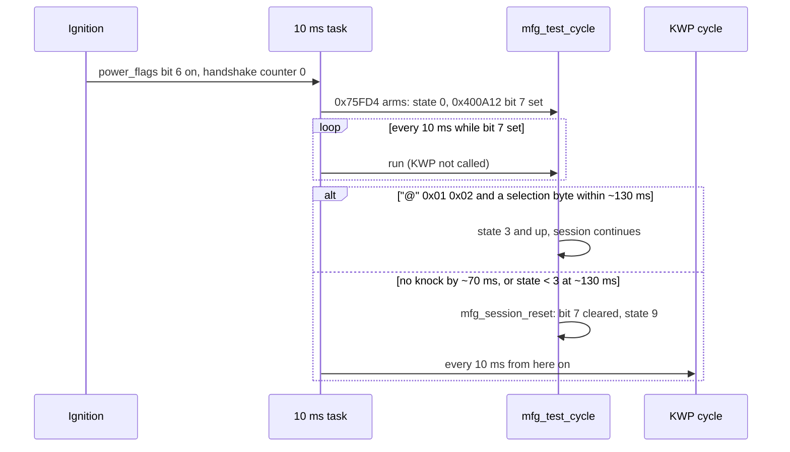
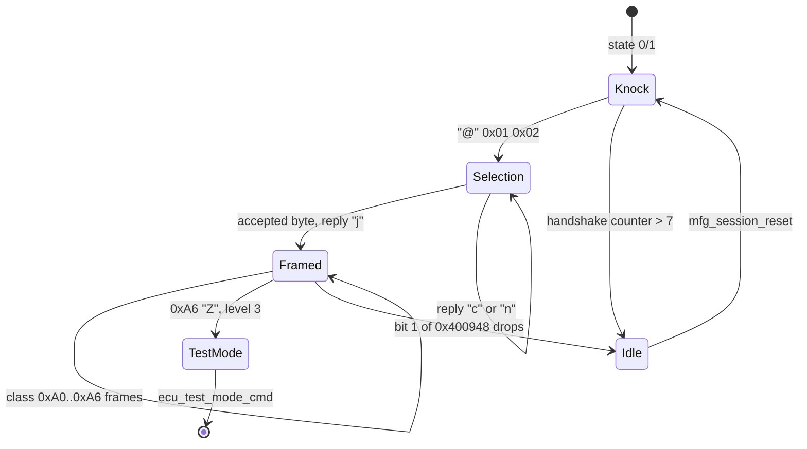

# mfg_test_cycle Analysis

2026-11-13 · Claude Doc: https://claude.ai/artifact/EM4B3qctXV2gQHSrF9718A

`mfg_test_cycle` at 0x76036 is a second diagnostic protocol on the same UART that carries K-line KWP: a 13-state manufacturing and end-of-line interface that reads and writes memory, EEPROM and the sensor ASIC, drives valves and the pump directly, and hands off to the flash loader. It is not reachable in normal operation: the 10 ms task runs it instead of the KWP cycle only while a mode flag is set, and its command set is gated by an access level that a tester raises step by step.

## Where it runs and how it is selected

There is one UART, and two protocols share it. The K-line transceiver hangs off the chip's SCI; `uart_isr` (0x70710) and the timed driver `uart_dispatch` (0x7008C, twelve states clocked from a timer channel, the K-line bit-timing engine) receive bytes into the request buffer at 0x40331D, the same buffer the CAN ISO-TP reassembler fills, and transmit from `uart_tx_buf` at 0x4032D2. KWP and the manufacturing protocol both read that request buffer and both write that transmit buffer; what differs is which state machine the 10 ms task hands the bytes to.

The choice is made in the normal 10 ms task body (unnamed, 0x71000, *proposed* `task_10ms_body`): if bit 7 of the protocol flags byte 0x400A12 is set it calls `mfg_test_cycle`, otherwise the KWP cycle (unnamed, 0xB00F4, *proposed* `kwp_cycle`). So on a car in normal operation the manufacturing protocol is not running at all, and KWP owns the wire. A second caller is `task3_10ms_testmode_cycle` (0x70FB6), the reduced task body that replaces the control and monitoring work when `ecu_mode_ge(3)` holds; it runs `mfg_test_cycle` unconditionally. Inside the protocol, `mfg_rx_service` refuses every frame unless `ecu_mode_ge(3)`, and the mode byte at 0x400A11 carries an access level in its top three bits that the session raises in steps (see the session section).

**What sets bit 7: a power-up window.** The setter is the session-start routine (unnamed, 0x75FD4, *proposed* `mfg_session_start`): it puts `mfg_state` at 0, points the descriptor at 0x400A18 and the frame initialiser 0x77690, sets bits 7 and 3 of 0x400A12 and clears bit 4 of 0x400A11. It runs twice: once from the application boot initialisation (unnamed, 0x6F6DA, *proposed* `boot_init_app`), and again from `mfg_window_tick` (0x70F38) on the first 10 ms tick after the debounced ignition flag (`power_flags` bit 6) comes on, whenever `mfg_handshake_counter` is 0. That counter is held at 0 while the ignition is off and counts 10 ms ticks up to 179 while it is on. So at every boot and every ignition-on the ECU arms the manufacturing protocol first, and KWP is not served at all for that moment.

The arm is short-lived. Inside `mfg_test_cycle` two timeouts call `mfg_session_reset`, which clears bits 7, 6 and 3, re-initialises the UART channel and parks the machine in state 9: in state 1, when no knock byte has matched and the counter has passed 7 (about 70 ms); and at the top of the cycle, when the window flag bit 0 of 0x400966 is set, the counter has passed 13 (about 130 ms) and the machine is still below state 3. The 179-tick bound (1.79 s) is not a knock deadline: it is how long `mfg_window_tick` keeps the window flag set, and the second check only runs while the flag is set, so it fires at 130 ms long before the flag expires. The same counter also holds a started session in state 5 until it passes 40 (about 400 ms) before framed commands are accepted. Once bit 7 is clear the next 10 ms tick runs the KWP cycle instead. The ignition-off path (unnamed, 0x75FFA, *proposed* `mfg_session_park`) only parks the machine and clears bit 3, so the arm happens again at the next ignition-on.

In practice: a tester that wants this protocol on a car must send `@` within roughly 70 ms of ignition-on and complete the knock and the selection byte within roughly 130 ms, over the K-line, since that is the only UART. Anything later is answered by KWP. A KWP tester, conversely, gets no answer in the first 100 ms or so after ignition-on, which is well inside the time a tester waits anyway. The separate `ecu_mode` level in the top bits of 0x400A11 is written only by this protocol's own level commands and by 0x75FD4, so the reduced test-mode task body is also only reachable by going through the knock.

## The session

The state variable is `mfg_state` at 0x400A28, switched through a jump table at 0x760D8. A session goes through three phases:

1. **Knock (states 0 to 1).** `mfg_handshake_match` waits for the three-byte sequence `@`, 0x01, 0x02. An in-order byte bumps a match count, a wrong byte breaks the chain, and if the handshake counter at 0x400964 passes 7 with no progress the session resets. There is no secret in this step.
2. **Selection (state 2).** One ASCII byte picks a test. `0`, `1`, `3`, `4`, `5`, `6`, `;` and `<` are accepted: if the readiness check `mfg_ready_check` (0x77626) passes and the test-operation bit (bit 2 of the operating-condition flags 0x400948) is clear the ECU answers `c` and stays; otherwise it answers `j` and advances to state 3. `2`, `7`, `8`, `9`, `:` and anything else are answered `n`. State 3 re-opens the UART with the configuration table the selected digit maps to (`mfg_uart_select_cfg`, 0x77176), state 4 arms the identification banner (`mfg_banner_send`, 0x77690) and sends the first framed reply (`mfg_frame_tx`, 0x773BC), sets the access level in the mode byte 0x400A11 to 1 and sets bit 1 of the operating-condition flags 0x400948.
3. **Framed mode (states 5 and 6).** After the handshake counter passes 40 the machine sits in state 6 and, each tick, lets `mfg_frame_check` (0x7723E) validate a frame: the request buffer holds a length at 0x40331D, a class byte at 0x40331E, a sub-command at 0x40331F and parameters from 0x403320, closed by a one-byte sum check. A valid frame is executed inline and answered with a tagged reply built at 0x4032D5 and sent by `mfg_reply_send` (0x77422) with a tag byte: `i` (0x69) for session answers, `r` (0x72) for reads, `e` for the echo class, `f` for level changes, `w` for valve-pulse status, and `c` as the negative answer. If bit 1 of 0x400948 drops, the machine falls to state 9, the idle state `mfg_session_reset` also returns to.

**States 7 to 12** live in separate functions reached through the jump table at 0x760D8: 7 runs `ecu_test_mode_cmd` with the stored command once the UART is idle (`mfg_state7_exec_cmd`, 0x7701C), then returns to 6; 8 and 9 share the idle handler (`mfg_state_idle`, 0x77102); 10 (0x7703C) waits for NVM job 0xFFF0 to finish and returns to 6; 11 (0x770CC) is the shutdown step that zeroes the pump level and the four inlet currents; 12 (0x7705E) performs the EEPROM write behind `X` through `nvm_request` mode 2 and returns to 6. The state numbers are the names these have; none is a project symbol yet.

**Access levels.** The top three bits of 0x400A11 hold a level 0 to 4. Class 0xA3 raises it: level 1 freely; level 2 after `op_mode_request` (0x8EBBC) with argument 8 succeeds (the operating-mode request the KWP session handler also uses; failure is flagged in bit 4 of the session error byte 0x400A10); level 3 only when the parameters are the ASCII pair `16`, after which interrupts are masked, `mfg_control_reset` (0x7770A) clears the control state, and the level 2 checkpoint is repeated; level 4 only with the pair `33`. Reads of class 0xA4 need level 1, writes of class 0xA5 need level 2 (NVM writes exactly level 2), and the hand-off to `ecu_test_mode_cmd` through class 0xA6 needs level 3. A level change answers `f` with the new level as an ASCII digit.

## Command classes

The class byte at 0x40331E selects a family, the sub-command at 0x40331F an action inside it. Parameters are ASCII hex: the parser at 0x77368 turns the eight characters from 0x403320 into an address and the eight from 0x403328 into a length or value, and the pair parser at 0x77544 turns hex pairs into bytes. Unknown classes or sub-commands set the "bad command" bit (bit 6) of the session error byte, which the next reply reports as a negative answer. The objects named in the table are listed in the glossary below it.

| Class | Sub | Level | What it does |
| --- | --- | --- | --- |
| 0xA0 | `0` | 1 | re-arm the identification banner (same as entering state 4): the banner sender then transmits the 30-byte identification block as an `i` reply on the next tick |
| 0xA0 | `1` | 1 | session info: the 4-byte session block as hex, the request buffer address, and the banner sender's address; 26-byte `i` reply |
| 0xA0 | `3` | 1 | the four protocol-version bytes `23 02 00 00` from ROM |
| 0xA0 | `4` | 1 | mode query and set: parameter `1` sets the escaped-frame bit of the mode byte; replies the mode digit, the identification-block pointer and six bytes of session flags |
| 0xA0 | `F` + `0` | 1 | parameter `1` sets bit 4 of the mode byte, `2` clears it; replies the bit |
| 0xA2 | any | 1 | echo: the request bytes from 0x40331F back as an `e` reply |
| 0xA3 | level 1..4 | - | raise or lower the access level, see the session section; with `1` and `5` as parameters also jumps to state 6 |
| 0xA4 | `T` | 1 | read from the data-item directory: address 0x234, 0x8234 or 0x10234 is redirected to the application header's directory pointer; bytes are sent as hex pairs |
| 0xA4 | `W` | 1 | the four raw wheel speeds as hex |
| 0xA4 | `G` | 1 | up to 59 bytes of the fault latch array at the given offset |
| 0xA4 | `U` | 1 | up to 59 raw bytes from any address |
| 0xA4 | `H` | 1 | raw QSPI exchange: up to 8 halfwords from the request are clocked out on the sensor-ASIC bus and the answer echoed back |
| 0xA4 | `I`, `J` | 1 | accepted, flagged as unsupported, echoed |
| 0xA4 | `X` | 1 | EEPROM read of up to 4 bytes through `nvm_request` with mode 10; reply byte 1 is a done flag |
| 0xA4 | `S` | 1 | memory read bracketed by the two ASIC hooks, which are empty functions in this image |
| 0xA5 | `R` | 2 | write 1, 2 or 4 bytes to any address |
| 0xA5 | `U` | 2 | write up to 24 bytes from 0x403329 to any address |
| 0xA5 | `T` | 2 | write hex pairs from the request into the data-item directory entry |
| 0xA5 | `X` | exactly 2 | EEPROM write of one byte through `nvm_request` mode 2; the block id is built from two ASCII hex digits |
| 0xA5 | `S` | 2 | memory write of 1, 2 or 4 bytes bracketed by the same empty ASIC hooks |
| 0xA5 | `P` | 2, pump needs 4 | actuator drive by mode nibble: isolation-valve currents (`usv_current_set` and its partner word, direct, via `usv_current_for_dp`, or scaled 0..255 to 0..2000 mA by 0x75180), the four inlet base currents, the wheel gains, twelve `valve_pulse_set` patterns from a signed bit mask, the pump level, and in mode 1 the actuator command block written field by field |
| 0xA6 | `Z` | 3 | hand off to state 7, where `mfg_state7_exec_cmd` runs `ecu_test_mode_cmd` with the stored command; a request length of 2 selects 0x7B, the test-mode entry |
| 0xA6 | `T` | 1 / 2 | data-item directory read and write: ids below 0x4000 are reads, 0x4000..0x7FFF writes, 0x8000..0xCFFF level-2 writes; id 0x8030 is a code entry that sets the two valve-mode nibbles |

**Glossary of the objects above**

| Object | Where | What it is |
| --- | --- | --- |
| request buffer | 0x40331D | length, class, sub-command, parameters; shared with KWP and the CAN ISO-TP reassembler |
| reply buffer and sender | 0x4032D5, `mfg_reply_send` (0x77422) | the payload is built from 0x4032D5; the sender prepends length and tag, appends the sum check and transmits through `mfg_frame_tx` (0x773BC, *proposed* name) |
| session block | 0x400A18..0x400A33 | 0x400A18 expected knock byte, 0x400A19 knock match count, 0x400A1C pointer to the identification block, 0x400A28 `mfg_state`, 0x400A2C/0x400A30 descriptor and banner pointers |
| session error byte | 0x400A10 | bit 0 and 2 NVM job pending or failed, bit 4 level checkpoint failed, bit 6 bad command |
| mode byte | 0x400A11 | bits 7..5 access level 0..4, bit 0 escaped-frame mode, bit 4 set by `F` |
| protocol flags | 0x400A12 | bit 7 protocol selected over KWP, bit 3 armed, bit 6 set by state 0 |
| inactivity countdown | 0x400A13 | reloaded to 125 by every valid frame, decremented every eighth tick, shutdown at 0 |
| banner sender, *proposed* `mfg_banner_send` | 0x77690 | right after a knock, sends the identification block once |
| identification block | 0xF68FC, 30 bytes | `0C 41 5A 31 52 41 45 30 30 30 30 38 20` then version bytes `90 00 0E 71 07 04 0B 09 1B 00 03 ...`; the text part reads `AZ1RAE00008` |
| protocol-version bytes | 0xD766E | `23 02 00 00` |
| application header | 0x40230 | three pointers the loader and tester can rely on: identification block 0xF68FC, data-item directory 0xD77C8, a third table 0xD71EC |
| data-item directory | 0xD77C8 | 8-byte records {id, length, address}, `FFFF` terminated: 0x0210 fault latch array (64 B), 0x0300 power-up frame counter, 0x0321..0x0324 raw wheel speeds, 0x0430 one byte at 0x401FF7, 0x0440..0x0445 six sensor signal words in the 0x4020xx block, 0x1010 the EEPROM block table 0xD7424 (252 B), 0x1031..0x1034 ROM addresses 0x40300, 0x4249C, 0x424A0, 0xF691C, 0x1591 the 13-byte loader record 0x400A54, 0x1592 four bytes at 0x17FFE4, 0x8030 the code entry 0x7468C |
| fault latch array | 0x402838 | one 16-bit latch word per fault group, the array `fault_set` writes |
| raw wheel speeds | 0x40094A, 0x40094C, 0x400950, 0x40094E | the four wheel speed words in capture order |
| ADC result array | 0x4009CE | analog inputs by channel, read by slot 6 |
| actuator command block | 0x401D0A..0x401D44 | per-channel target (0x401D0A, 4 × u16) and flag (0x401D12), per-channel words at 0x401D16, two 3-byte packed fields at 0x401D1E and 0x401D21, a global word at 0x401D3C and the isolation-valve current words 0x401D42/0x401D44; consumed by the valve output stage at 0x74220 and the pressure code at 0x872A8 |
| current scaler, *proposed* `current_scale_2000` | 0x75180 | maps 0..255 to 0..2000 mA |
| level-2 checkpoint, *proposed* `op_mode_request` | 0x8EBBC with 8 | the operating-mode request the KWP session handler also uses: with the ignition on it asks the mode state machine at 0x401FE4..0x401FF1 (through 0x8E6E2) for mode 8 and records the outcome |
| level-3 reset, *proposed* `mfg_control_reset` | 0x7770A | clears the control state (fault reaction words, pressure state, pump flags), resets the frame decoder and writes ASIC register 0x264 through 0x72162 |
| readiness check, *proposed* `mfg_ready_check` | 0x77626 | shared with the end-of-line monitor and the offset record: returns 0 when the operating-state nibble 0x18 reads 3 on both halves or 0x8E0C4 disagrees, unless bit 2 of 0x400948 is set |
| operating-condition flags | 0x400948 | a global flag byte: bit 1 is set when the framed channel opens (state 4), bit 2 marks bench or test operation and suppresses the fault history ring and the readiness check; also read by the CCP toggle and the valve calibration save |
| task flag byte | 0x400966 | bit 0 manufacturing window open (counter below 179 with ignition on), bit 6 power-up window enable, bits 4 and 5 set at boot |
| pump control words | 0x4009D4, 0x400A7C, 0x400A7E | duty in the high byte of 0x4009D4, state and permission bits in the other two; bit 1 of 0x400A7E is the pump test flag |
| UART configuration tables | 0xD7674..0xD7704, `uart_cfg_table` | 16-byte records {driver, baud-divisor id, bit timings}; the selection byte picks one through `mfg_uart_select_cfg` (0x77176, *proposed* name), so each test digit runs the serial link at its own speed |
| ASIC hooks | 0x6C6A0, 0x6C690 | empty functions in this image; `S` degenerates to a plain memory access |

## The factory command table and the frame decoder

Beside the inline classes there is a second, older-looking path. `mfg_rx_service` (0x77952), called every tick with mode 0x82, refuses everything unless `ecu_mode_ge(3)`; with the escaped-frame bit (bit 0 of the mode byte 0x400A11) set it runs `mfg_rx_decode_frame` (0x777B8), which walks the descriptor buffer (decoder state word 0x4033E0, an escape pair 0x4B/0x27, a per-byte transform in `mfg_rx_xform_byte`, 0x777A0). `mfg_frame_validate` (0x778B2) sums the frame bytes, moves the descriptor state from 0x40 to 0x80 on a good sum, and arms `mfg_cmd_dispatch` (0x779D6), which calls `mfg_cmd_table[idx]` for an index below 30 and writes a done flag into the descriptor.

`mfg_cmd_table` at 0xD7750 holds 30 slots, 4 of them empty (5, 7, 8 and 28). Every slot has been read. Names in plain type are symbols the project already has; names marked *proposed* are mine, chosen from what the function does; they were applied to the M3 project on 2026-11-13 (plate comment "named by hand from the mfg_test_cycle / kwp_dispatch analysis docs") and ported by signature to the 1M and the two 335i projects, where 36, 33 and 32 of the 44 matched. The ones that did not port are the very short helpers below the matcher's size floor and the task bodies whose call sequences differ per variant.

| Slot | Target | What it does |
| --- | --- | --- |
| 0 | *proposed* `mfg_addr_directory` (0x779B6) | address directory: index 0..18 returns a well-known address from the table at 0xD7704 (power-up frame counter, raw wheel speeds, valve stage arrays, request and transmit buffers, the protocol-version bytes) |
| 1 | `valve_pulse_set` (0x740BC) | valve pulse pattern for one of twelve channels |
| 2 | `pump_motor_set_level` (0x73250) | pump motor PWM level 0..15; the permissive path needs access level 4 |
| 3 | *proposed* `pump_status_get` (0x73078) | selector 0..14 returns pump duty, state code and flags from the pump control words |
| 4 | *proposed* `pump_test_flag_set` (0x732D2) | bit 1 of the pump control word 0x400A7E, only at access level 4 |
| 6 | *proposed* `adc_channel_get` (0x6FB30) | analog input by channel id from the ADC result array |
| 9 | *proposed* `mfg_reply_send` (0x77422) | send a tagged reply |
| 10 | *proposed* `mfg_hex_format` (0x772FC) | format a value as hex characters |
| 11 | *proposed* `mfg_hex_byte` (0x77338) | format one byte as two hex characters |
| 12 | `uart_rx_peek` (0x6D068) | peek the receive buffer |
| 13 | *proposed* `uart_tx_send` (0x6D044) | UART transmit entry, choosing the send path by the UART flag word |
| 14 | `spi_driver_a` (0xD4DC0) | SPI transfer to the coding EEPROM on chip-select 2 |
| 15 | *proposed* `asic_reg_xfer16` (0x779C8) | sensor ASIC register transfer, low 16 bits returned |
| 16 | `nvm_read_sync` (0x6E9C4) | blocking EEPROM read, opcode 3, bytes inverted |
| 17 | *proposed* `nvm_write_sync` (0x6E946) | blocking EEPROM write: write-enable, then opcode 2 with inverted data |
| 18 | *proposed* `mfg_nvm_wait_enter` (0x775A4) | load the inactivity countdown and enter state 10 (wait for the NVM job) |
| 19 | *proposed* `mfg_idle_timer_restart` (0x7760C) | reload the inactivity countdown to 125; `mfg_idle_timer_tick` (0x775B0) decrements it every eighth tick and shuts the session down at 0 (about 10 s) |
| 20 | *proposed* `mfg_flag_checkpoint_fail` (0x7761C) | raise bit 4 of the session error byte |
| 21 | *proposed* `can_reconfig_loader_vector` (0xD5158) | same CAN reconfiguration as `jump_to_bootloader`, then a call through the vector at 0x204 in the loader block with argument 2 |
| 22 | `jump_to_bootloader` (0xD5044) | checks the `SBL!` marker at 0x4010 and the vector at 0x4000, sets both CAN controllers to extended-id masks, calls the secondary bootloader |
| 23 | `mfg_rx_buf_end` (0x7778A) | end of the receive descriptor buffer |
| 24 | *proposed* `nvm_status_read` (0x6EA84) | EEPROM status register read |
| 25 | *proposed* `nvm_status_write` (0x6EA36) | EEPROM write-enable plus a two-byte command (status register write) |
| 26 | *proposed* `mfg_frame_check` (0x7723E) | length and sum check of a framed request |
| 27 | *proposed* `mfg_hex_parse` (0x77368) | ASCII hex parser |
| 29 | `ecu_test_mode_cmd` (0x6CEF6) | test-mode command: 0x7B enter test mode, 0x2D loader via `jump_to_bootloader`, 0x81 loader-valid reset, 0x84 loader-valid read |

The table is a toolbox rather than a command set: formatters, the UART and SPI primitives, the EEPROM read, write and status-register primitives, the pump and valve drivers with their status getters, the session timers, and the two exits to the loader. The inline classes of the previous section are built from the same helpers, so this table is the dispatch for the escaped-frame variant of the same protocol. One consequence for the `P` family: the pump driver's permissive path and the pump flag both check that the access level is exactly 4 (0x77596), so driving the pump from the bench needs the `33` pair, not just level 2.

## Open questions

- [x] **What raises bit 7 of 0x400A12** is resolved: the session-start routine 0x75FD4, run at boot and at every ignition-on, with the knock timeouts clearing it again within about 130 ms (see the first section). The remaining question there is whether the line tester drives the K-line transceiver or the SCI pins directly, which the firmware cannot tell.
- [ ] **The level-2 checkpoint** at 0x8EBBC with argument 8, and what the `16` and `33` pairs for levels 3 and 4 are checking against. Both look like fixed strings rather than a seed-and-key.
- [x] **Slot 22 of the command table** is resolved: it is `jump_to_bootloader` directly, guarded by the `SBL!` marker at 0x4010 and a valid vector at 0x4000, and it prepares both CAN controllers before the hand-off. The 0x2D path inside `ecu_test_mode_cmd` reaches the same function.
- [ ] **The 0xD766E table** behind class 0xA0 `3`, and the parameter block behind `H` at 0x7749A.
- [ ] **The physical path**: whether the line tester speaks this protocol through the K-line transceiver or on the SCI pins before it. The firmware cannot tell; the driver is the same timed UART state machine either way.

## Method and provenance

All addresses are from the E9x M3 image 7846816A, project `projects/E9x_M3_7846816A`, after the SLEIGH byte-width fix (commit ff817f1), so byte and halfword accesses in the decompiles are now sized correctly. Readings come from Ghidra's decompiler run headlessly on snapshot copies of the project with read-only flash respected; the command classes were read from the inline state machine in `mfg_test_cycle`, the table from the raw bytes at 0xD7750, and nothing was written to the project. Names such as `mfg_test_cycle`, `mfg_handshake_match` and `mfg_cmd_dispatch` are from the cmg5461 symbol map and its plate comments; where a plate comment makes a claim this pass did not verify, the text says so. The companion documents are `kwp_dispatch.md` and `kwp_sid22.md`; this one covers only the non-KWP protocol on the same UART.
