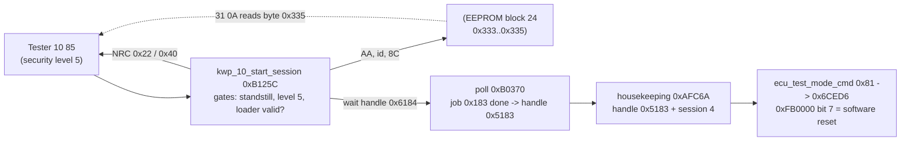

# The program-request record (programming-session marker)

As of 2026-11-13. Analysis notes for the MK60-M-Core-Disassembly-Process repository. Companion to `kwp_dispatch.md` (the fuller trace of the services) and `kwp_sid22.md` (the EEPROM block map). All addresses are from the E9x M3 image `7846816A` unless stated otherwise; E46 facts are from hardware on the bench units (ZCP and non-M) and the chip-off dumps.

## Summary

`10 85` StartDiagnosticSession(programming) is the BMW request to hand off from the application to the factory flash loader. On the MK60E5 the handler does not reset by itself: it writes a three-byte **program-request record** `AA <tester> 8C` into the EEPROM, then a deferred housekeeping path triggers a **software reset** (a write to a hardware register) that reboots into the loader. The record is the state that crosses the reset; the loader, which lives in the factory boot sector below `0x40000` and is **not part of the `.0pa` images**, reads it on the other side.

The whole writer side is traced below. The reader side — what the loader actually does with the record, and in particular whether it honours the record on any reset or only on the software reset — cannot be determined from the images and is the single open question that decides whether this route is usable on the E46.

The base **E46** cannot drive any part of this flow (no `10 85`, no routine `31 0A`, no `0x11` ECUReset), and the one externally reproducible step — writing the record via `$3D` — is blocked by two unknowns: the correct E46 offset cannot be pinned, and the software reset cannot be produced from outside.

## The record

Three bytes, `AA <tester> 8C`:

| byte | value | source |
| --- | --- | --- |
| +0 | `0xAA` | immediate (`movi 0x2a; bseti 7`) |
| +1 | tester id | low byte of the 32-bit word at `0x404844` |
| +2 | `0x8C` | `0xAA - 0x1E` |

The tester id is **dynamic** — the low byte of `0x404844`, which `can_rx_6F1_tester_cb` fills from the CAN receive queue with the decoded 11-bit id of the last tester frame (the receive interrupt `0x6DA5C` through the mailbox reader `0xD3D10`). For the usual tester address `0x6F1` that byte is `0xF1`, so the record reads `AA F1 8C`. A request that arrived over K-line records whatever CAN tester frame was seen last.

**Location (E5):** EEPROM **block 24** (the identification/VIN block, record id `0x183`) **offset `0x11`** = logical `0x333..0x335` (`0x333`=AA, `0x334`=tester, `0x335`=8C). Written through descriptor `0xF3388 = {buf 0x403322, id 0x183, len 3, off 0x11, dir write}`.

Two sibling descriptors are present but unreferenced by the application — `0xF3358` (writes `0x334..0x335`) and `0xF3364` (writes `0x3FF`); they look like an older layout of the same record.

## The writer: `10 85` (`kwp_10_start_session`, 0xB125C)

The `0x85` branch is gated four ways; any failure answers an NRC and writes nothing:

1. standstill — `module_method_dispatch(4, 0, 100)` (wheel-speed-raw) must return 0;
2. **`kwp_seclevel` (0x409545) must be 5** — the level that only routine `31 08` (the MD5 seed-key) grants;
3. standstill checked again;
4. **a valid loader must be present** — `ecu_test_mode_cmd(0x84)` must return 1. That call returns the byte at `0x400A49`, which start-up code `0x6F454` sets when the loader block selected through table `0xD7298` begins with the signature `0x66666666`. A unit with no valid loader answers NRC `0x40` downloadNotAccepted.

When the gates pass (read the stores from the disassembly at `0xB1332..0xB1362`, not the decompiler, which mis-sizes them):

1. sets `kwp_session` (`0x409544`) to **4**;
2. writes `AA`, tester, `8C` to the request buffer at `0x403322..0x403324`;
3. queues descriptor `0xF3388` — the write of those three bytes to block 24 offset `0x11` (logical `0x333..0x335`);
4. stores deferred-reply **wait handle `0x409436 = 0x6184`** and layout code `0x4094D5 = 2`, clears `diag_resp_ready`, and **returns without a reply**.

`0x6184` is a wait handle, not a reset reason: its low bits `0x184` = record id `0x183` + 1 ("wait for that NVM write"), and the upper bits are the timeout mode. `10 85` is the only writer that uses the `0x6000+` form.

## The reset (software reset into the loader)

The reset is not in the handler — it is downstream of the deferred reply:



- Each KWP tick the poll routine `0xB0370` sees the handle above `0x5FFF`, checks NVM job `0x183`, and on completion turns the handle into `0x5183`.
- The housekeeping routine `0xAFC6A`, seeing handle `0x5183` with the session at 4, calls `ecu_test_mode_cmd(0x81)`.

`ecu_test_mode_cmd(0x81)` is the reset routine `0x6CED6`:

```
if [0x400A49] == 0: return            # no valid loader -> do nothing
jsri 0x6C6A0                          # pre-reset step (flush/commit)
[0xFB0000] |= 0x80                    # set bit 7
spin forever                          # wait for the reset to take
```

It writes **no persistent reason anywhere beyond the EEPROM record** — only the hardware reset bit. So the only state that crosses the reset is (a) the EEPROM record and (b) whatever the hardware **reset-source** register records (software-reset vs power-on). The application never sends `50 85`; the loader is expected to answer the tester after the reset, which is why the record carries the tester id.

### `ecu_test_mode_cmd` (0x6CEF6) command set

A small dispatcher on the command byte, all reachable only by executing code (never by a diagnostic request):

| cmd | effect |
| --- | --- |
| `0x7B` | irq-disable + a four-call teardown sequence |
| `0x2D` | writes the ASIC registers `0xF50000` / `0xF60000` — a mode/prep path |
| `0x81` | the software reset into the loader (`0x6CED6`, `0xFB0000` bit 7) |
| `0x84` | reads the loader-valid byte `0x400A49` |

`0xFB0000`, `0xF50000`, `0xF60000`, `0xD50108` are SC550080 ASIC registers; without a datasheet only `0xFB0000` bit 7 (reset) is named with confidence.

## The reader: routine `31 0A`, and the loader

Within the application the only reader of the record is **RoutineControl routine `0x0A`** (`31 0A`): it queues a one-byte read through descriptor `0xF334C = {id 0x183, off 0x13, len 1, read}` — logical `0x335`, the `8C` byte — into `0x40943E`, parks the reply on wait handle `0x184`, and the KWP cycle then sends `71 0A <byte>`. Expected values: `8C` on a unit that has been handed to the loader and whose loader left the record in place, `00` on a unit that never has. `10 85` is the only writer of `0x333..0x335` and `31 0A` the only in-application reader, so the two belong together.

The **boot-time reader is in the factory flash loader**, which lives below `0x40000` and is excluded from all four reflash `.0pa` images. Whether it keys on the record alone or also on the reset-source register, and whether it clears or rewrites `0x335` after a successful download, **cannot be traced in this project**.

## The E46: what differs, and what has been tried

The base (non-M) E46 MK60 is a stripped variant of the same family and **cannot drive this flow**:

- `10 85` -> `7F 10 12` (no programming session);
- routine `31 0A` -> absent (confirmed by `scan-all`); no in-application reader of the record;
- `0x11` ECUReset -> `7F 11 11` (no commanded reset service either).

`$3D` WriteMemoryByAddress does work and **persists to the physical chip** across a power-cycle (tested), so the record can be written from outside — but `$3D` writes logical NVM, not MCU registers, so the software reset (`0xFB0000` bit 7) **cannot be produced**.

**The E46 offset is unresolved.** The record sits in block 24 (the identification/VIN block), but the exact E46 logical address cannot be pinned:

- the `id -> base -> size` directory lives in the E46 **flash**, not the EEPROM (the E5 keeps its block table at flash `0xD7424`), so it cannot be decoded from a config-EEPROM dump — and the flash is the thing we are trying to read;
- the record is **absent from the E46 EEPROM** — bytes `0xAA` and `0x8C` appear nowhere in the 512 B of any dump (the loader presumably clears it after a successful flash, so a normally-running unit has none);
- the block **layout differs** from the E5's: the E46 VIN is 14 ASCII chars at `0x150`, the E5's is a 7-char short VIN at `0x3A4`, so the E5's "record is `0x71` before VIN" relation does not transfer.

Known E46 EEPROM anchors (fresh `$23` dump): coding at `0x120..0x12E` (DID `0x3000`), VIN `AA00000JR16825` at `0x150..0x15D`, Prüfstempel `3D 68 25` at `0x15E..0x160` (DID `0x1000`), fault/event records at `0x069..0x087`.

### Hardware tests run

| when | write | reset | result |
| --- | --- | --- | --- |
| prior session | `AA F1 8C` at logical `0x11` | cold power-cycle | booted app (offset wrong — low ident-overlay region) |
| 2026-11-13 | `AA F1 8C` at `0x130` | cold power-cycle | record **persisted**, booted app (offset still wrong — `0x130` is block 10 / coding, not block 24) |

Neither test used the correct block. The `0x130` estimate came from wrongly anchoring on coding (block 10, id `0xA3`), which is a different block from the record's (block 24, id `0x183`).

## The decisive open experiment

The reader is a black box, so the usable-or-not question can only be answered by hardware. The cleanest test is on an **E5**, where the offset and format are known:

> Write `AA F1 8C` at logical `0x333..0x335` via `$3D`, cold power-cycle, and check whether a programming session opens (`10 85` accepted, `0x50`) / a loader answers.

Outcomes:

- **boots to the loader** -> the record alone + any reset is the trigger; the software reset is not required -> the E46 route is viable, and pinning the E46 offset becomes worthwhile;
- **boots to the app** -> the software reset (or more of the handoff context) is required -> the record-write route is dead, proven on the unit where everything is known-correct.

Practical notes: the E5 is DCAN-diagnostic, so `$3D`/`$23` and `prog-request` would need a CAN ISO-TP path (the reads are transport-aware; the NVM write path is still K-line only). `$3D` needs the level-`0x7F` unlock. And if the test succeeds, clearing the record back out means talking to the loader, not the app's `$3D`, so snapshot first and keep a chip-off/CH341A restore as a backstop.

## Tooling

`prog-request` (bench tool) writes `AA <tester> 8C` at a candidate offset, snapshots first, waits for the operator to power-cycle, then classifies app-vs-loader via `prog_session_open` (`10 85` -> `0x50`) and an app-silence + boot-knock fallback, restoring the window afterward. It now runs over **both transports**: K-line (E46, default `~0x0DF` estimate) and **CAN ISO-TP** (E5, `prog-request --can --lo 0x333 --hi 0x335`, the known block-24 +0x11 offset). The CAN `$3D`/`$23` path and a `unlock_7f_can` exist for the E5 test; the `0x7F` unlock reuses the E46 key algorithm and is unvalidated on E5 hardware (a rejection would mean the E5's `0x7F` key differs, not a wiring fault).

## Method and provenance

Readings are from the E9x M3 image `7846816A` (`projects/E9x_M3_7846816A`), via the headless Ghidra pipeline, and the hand-disassembly of `0xB1332..0xB1362`, `0x6CED6`, and `0x6CEF6`. The dispatch, deferred-reply and EEPROM-block facts are cross-referenced against `kwp_dispatch.md` and `kwp_sid22.md` in this directory, which carry the fuller traces. E46 facts are from the bench units' `$23`/`$22` responses and the chip-off config-EEPROM dumps; the factory flash loader (below `0x40000`) is in none of the images, so all statements about what it does at boot are explicitly marked as unknown.
