# MK60 Bench Harness

## Overview

This doc goes over how to build a two-part harness for interacting with Teves MK60 DSC modules on the bench.

### MK60 -> OBD II Harness:

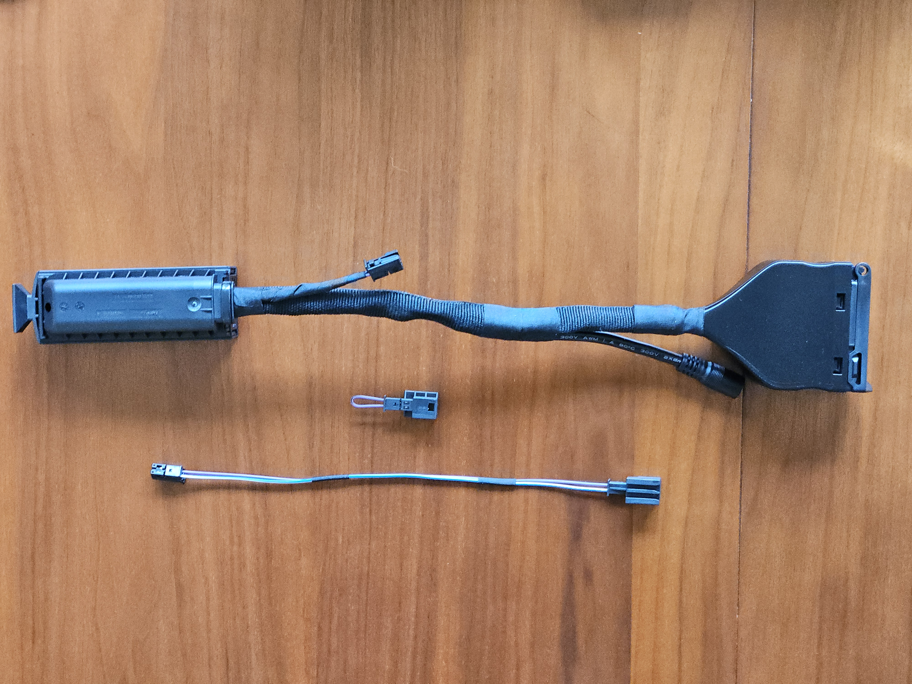

### Gauge.S Interface:

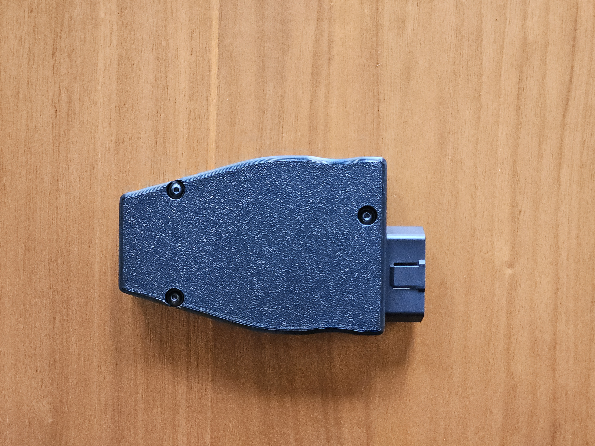
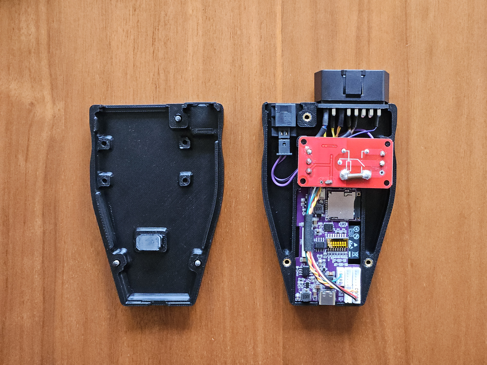

This split exists to emulate the wiring on an actual car. It allows the Gauge.S interface to be used in-car and also allows for testing with regular K+DCAN cables on the bench.

You can get away with a lot if you just use the `MK60 Harness` portion with a K+DCAN cable. However, there are some limitations, notably:

1. No CCP over CAN.
2. No remote ignition control.
3. Much higher roundtrip latency, which makes the knock into the manufacturer diag protocol significantly less reliable.

## Power

This harness is designed to be used with a barrel connector, wall wart-style 12V power supply. I'm using one that outputs 3A and have yet to reach its limits. The design assumes a center positive polarity on the power supply.

> [!NOTE]
> Make sure to physically separate the electronics portion of the MK60 from the valve body/pump. Accidentally actuating the pump or solenoids will draw much more power than the electronics do by themselves.

## MK60 -> OBD II Harness

### Parts List

#### Required:
- MK60 Connector (x1) - BMW 61136954574
- MK60 Connector Medium Pins (x4) - BMW 61136901726
  - TE 1355556-1 works and is much cheaper, but technically not designed to be used with grommets.
- MK60 Connector Large Pins (x4) - BMW 61138364846
  - TE 968121-2 is a direct replacement.
- OBD II Connector - BMW 61138380698
- OBD II Connector Housing - BMW 61138373323
- OBD II Connector Pins - BMW 61138366598
  - TE 969019-3 is a direct replacement, but hard to find in reasonable quantities.
- Two pin female connector for ignition control. I used TE 1355470-5.
- Two pin male connector for ignition control. I used TE 929080-5.
- Ignition control female pins. I used TE 963715-1 for 0.5 mm2 wires.
- Ignition control male pins. I used TE 963716-1 for 0.5 mm2 wires.
- 5.5 x 2.1/2.5 mm female barrel connector pigtail.
- Assorted colored/sized wire. I used 0.5 mm2 for everything except the 12V and GND MK60 rail wiring. The rails got 2.5 mm2.
- Assorted heat shrink, TESA tape, wire sleeve, etc. to tidy things up.

#### Optional:
- MK60 Connector Slide Lock (x1) - BMW 61136901739
- MK60 Connector Covering Cap - BMW 61136931961
- MK60 Connector Medium Pin Grommets for 0.5 - 1.0 mm2 wires (x4) - BMW 61138366245
  - TE 967067-1 is a direct replacement.
- MK60 Connector Medium Pin Grommets for 0.13 - 0.35 mm2 wires (x4) - BMW 61138366247
  - TE 967067-2 is a direct replacement.
- MK60 Connector Large Pin Grommets for 1.0 - 2.5 mm2 wires (x4) - BMW 61138372628
  - TE 967607-1 is a direct replacement.
- MK60 Connector Large Pin Grommets for 2.5 - 4.0 mm2 wires (x4) - BMW 61138372638
  - TE 967608-1 is a direct replacement.
- 3D printed boot

A lot of these parts can also be found used in your local junkyard or online, since they came on a lot of BMWs from the era. If you get an MK60 connector with a long enough pigtail, you can even reuse the wiring and crimp the OBD pins on.

> [!NOTE]
> The optional parts list includes alternatives to choose from for the medium/large pin grommets. If buying, choose the ones that match your wire sizes, no need to buy all sizes.

### Schematic

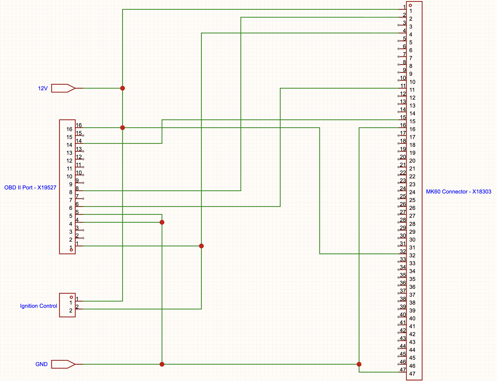

### Layout

I laid the harness out as follows. Staggering the 12V and GND splices helps keep its profile down.

### OBD II Connector Boot

I designed and printed a boot for the OBD II connector, to make it easier to handle and help avoid ripping out the wires. 

The design incorporates a captured rigid retainer to interface with the clips on the BMW OBD II connector housing. I printed the retainer out of ABS and the boot out of 95A TPU.

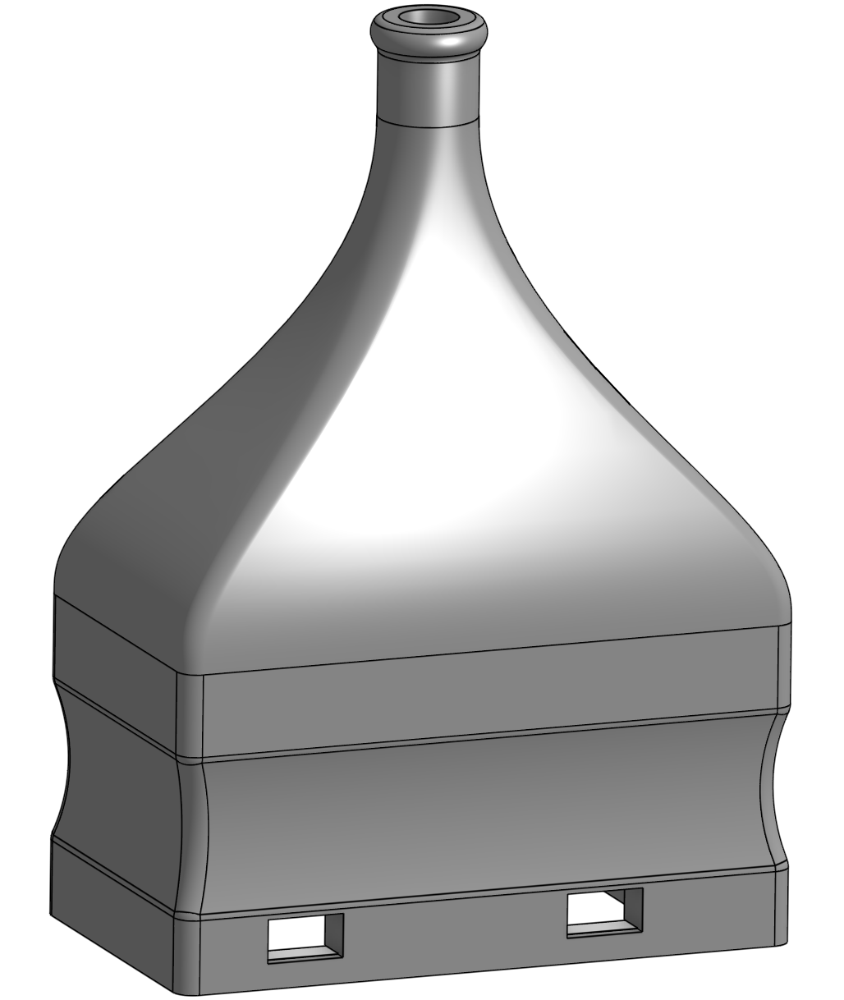
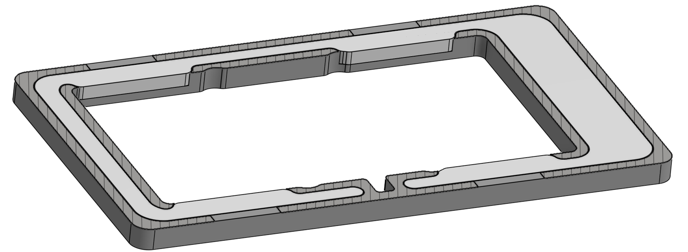

If your printer can handle swapping filaments mid-print, this is a simple part to print. If not, print the retainer first, then add a pause to the boot's G-code right before it bridges the cavity. Once the printer pauses, insert the retainer and continue the print.

STEP files in `./parts/e46_obd_ii_port_boot/`.

[Read-only, copiable, exportable CAD here.](https://cad.onshape.com/documents/69b25983285a9d74341a17d6/w/d73cbcba503d01310106d8b9/e/0783e49d8b62aaf847190bb8)

### Ignition Control

The harness is designed so that the equivalent KL15 ignition signal is separate from the main KL30 12V rail. This allows you to control the module's ignition without disconnecting the entire rail.

The schematic shows a two pin connector that you can either manually jump or control with a relay whenever you want the ignition on signal. You  More on the relay approach below.

> [!NOTE]
> As designed, the connector has 12V live at all times on pin 1. This is on purpose so that whatever is controlling the ignition only needs to act as a jumper and does not need to supply any current to the module.

### Final Product

The stubby two pin female connector is the manual ignition jumper. The longer two pin sub-harness is used for relay control.

## Gauge.S Interface

While this is not needed for interfacing with the MK60, it does simplify a lot of steps. This interface is built around a V5 Gauge.S board, which has the necessary HW to interface with both K line and CAN. It also includes a relay that Gauge.S can control, which makes knocking into the manufacturer diag protocol incredibly reliable.

The V5 Gauge.S board is ESP32-S3 based, so it can be flashed and talked to via USB C. [Sorek](https://github.com/handmade0octopus)'s [FW update script](https://github.com/handmade0octopus/Gauge.S-sd-updater/blob/028174d0c403c15f290b7071eb217b3eaff413ce/src/main.cpp) can be used to flash back to [stock Gauge.S FW](https://github.com/handmade0octopus/gauge.s-sorek.uk/releases) from an image on the SD card, if ever desired.

Many alternative approaches exist for this part. I chose this route mainly because I had an extra V5 Gauge.S lying around.

### Parts List

#### Required:
- V5 Gauge.S
  - Boards older than V5 might also work, but they do not have a USB C port, so you will need to interact with them [via an FTDI programmer](https://github.com/handmade0octopus/Gauge.S-sd-updater/blob/028174d0c403c15f290b7071eb217b3eaff413ce/README.md#how-to-flash). The case is not designed to accommodate this.
- ZH 1.5mm JST connectors + wires.
- Relay board
- OBD II Plug
- Two pin TE 1355470-5 female connector
- Assorted colored/sized wire. I used 0.5 mm2 for everything except the Gauge.S JST connectors.
- Assorted heat shrink, TESA tape, wire sleeve, etc. to tidy things up.

#### Optional (for case):
- CNCKitchen M3 x 3 Heat Set Inserts (x3)
- M3 x 16 screws (x3)
- M3 washers (x3)
- 3D printed case

### Schematic

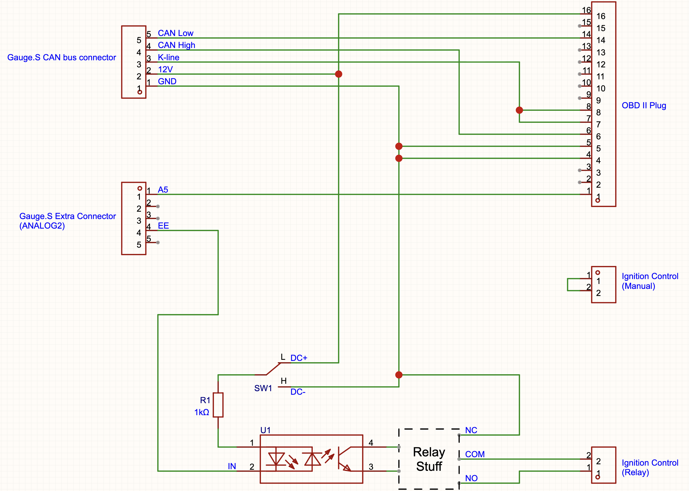

### Gauge.S Setup

You'll need to [flip DIP switch 1 on the Gauge.S board](https://github.com/handmade0octopus/gauge.s-sorek.uk/wiki/Home/1cd1f27e5dc329a63b43b6e393da814de5756c3e#dipswitch-configuration) to connect a 120 Ω resistor between CAN High and CAN Low, like so:

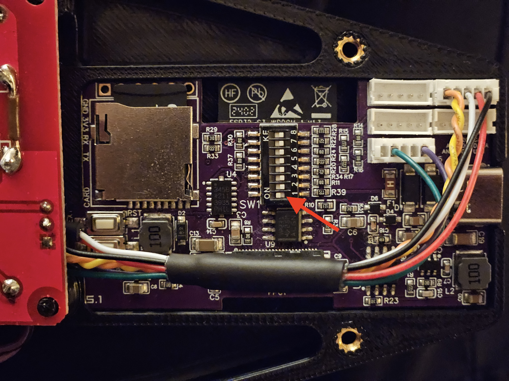

The board will also need custom FW, which can be flashed with the `E46 MK60 Tool` SW.

### Relay Board

Although extremely overkill, I went with an optocoupled relay board. K line is 12V referenced and the optocoupler removes any possibility of eletrical noise leaking into K line.

The board I used is [a random one off of the internet](https://www.amazon.com/dp/B00LW15D1M). It's extremely likely that this exact board will not be around forever, but the design is extremely common and the case can be easily adapted to fit other variants.

This is what the one I bought looks like:

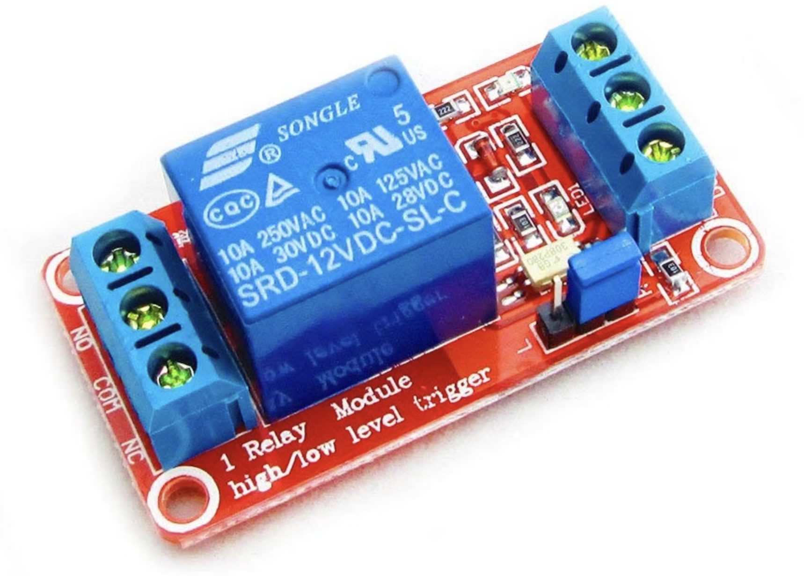

> [!NOTE]
> To make the case lower profile, I unsoldered the screw terminals and ran the wires directly to the through holes on the PCB. I also unsoldered the `L/H` selection header and soldered a jumper to select the `L` position.

> [!NOTE]
> To make my life easier, I jumped the `DC-` pin on the relay to the `NC` pin directly in front of it. Avoids running an extra wire to GND.

> [!IMPORTANT]
> Make sure the wire carrying 12V in from the MK60 harness is **NOT** on the `COM` pin. If it is and you turn on the relay, you'll short the 12V and GND rails together.

### OBD II Plug

Much like with the relay board, I bought [a random OBD II plug off the internet](https://www.amazon.com/dp/B0B3MDYTP2). I also don't expect this listing to stick around forever, but this part is standardized, so most variants should fit.

This is what the one I bought looks like:

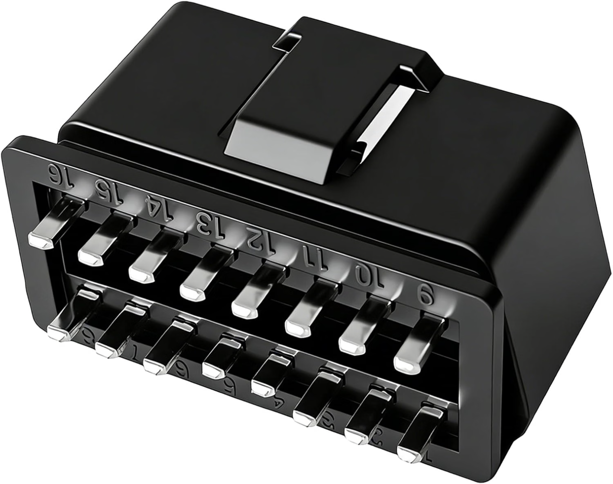

### Layout

I laid the wiring out as follows. Refer to the Gauge.S wiki to double check pinouts.

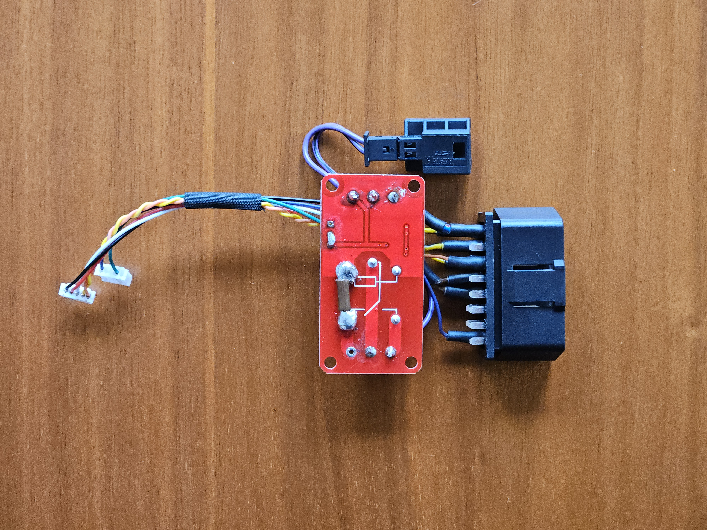
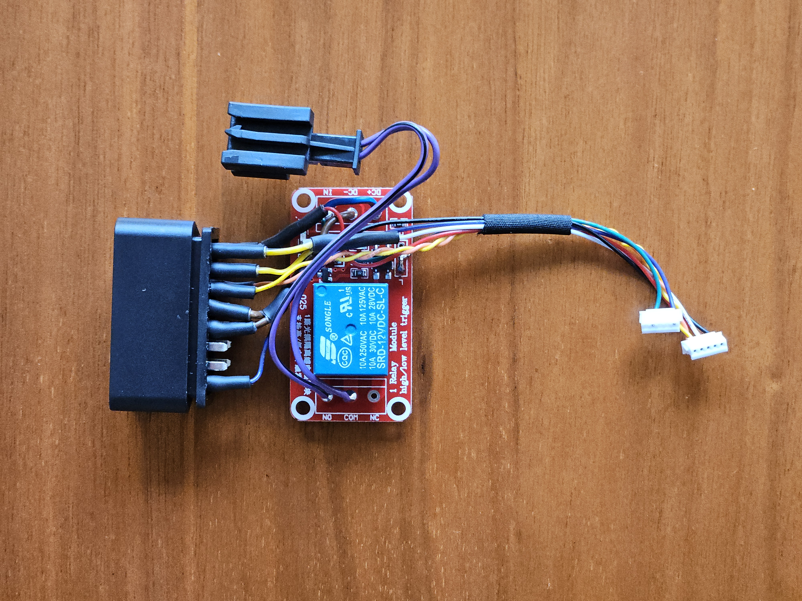

### Case

No tricks to printing these parts. I used ABS and laid the flat faces of the clamshells down on the bed. Make sure there is adequate support for the circled overhangs in the following images:

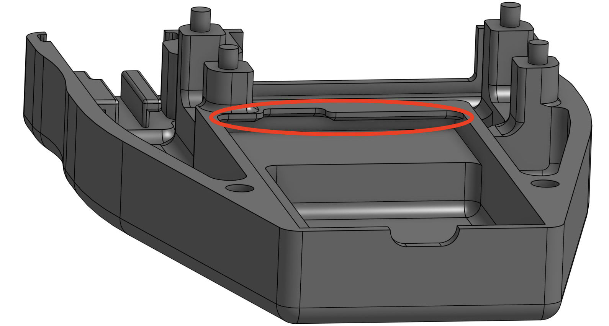
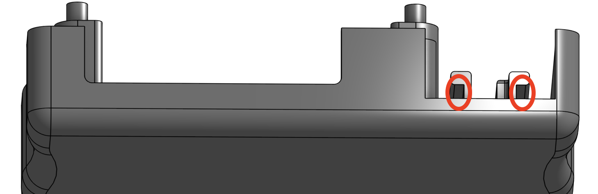
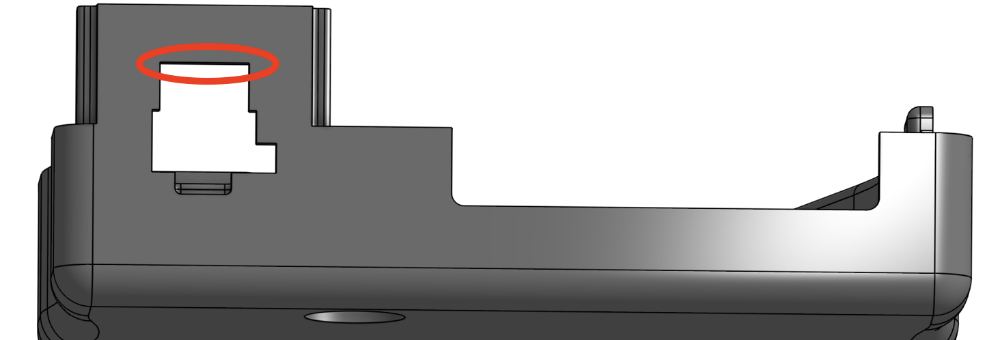

The case is designed with a spot for a print-in-place spring. This spring holds down the Gauge.S board when the case is assembled, since that board has no mounting provisions. Make sure to print this part in the following orientation:

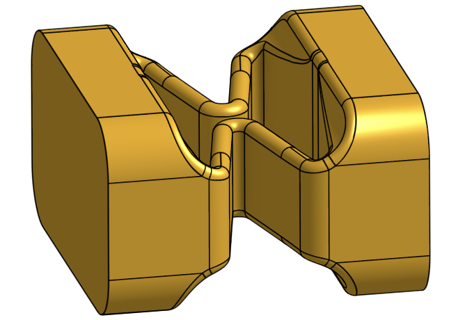

Before final assembly, three M3 heat set inserts will need to be installed in the bores on the bottom clamshell.

> [!NOTE]
> The parts are toleranced with ABS's shrink rate in mind. You might find that they don't fit as well if you use another material.

STEP files in `./parts/gauge.s_mk60_interface_case/`.

[Read-only, copiable, exportable CAD here.](https://cad.onshape.com/documents/03361fe1fa944463304b9d48/w/4c4a90c2810c505f64eb2cfb/e/31041c7b0e95d60c733fce20)

### Assembly

1. Start with the bottom clamshell down on a surface.
2. Slide two pin connector in until it clicks into place.
3. Slide OBD II connector into place.
4. Slide relay board over the four retaining pins, making sure to route wires as shown in the pictures below.
5. Slide Gauge.S board into place, starting with the end that goes under the lip in the middle of the case.
6. Plug connectors into Gauge.S.
7. Slide top clamshell into place, making sure perimeter lips and bores for the relay retaining pins aren't getting caught up on anything.
8. Install and tighten the three M3 screws.

### Final Product

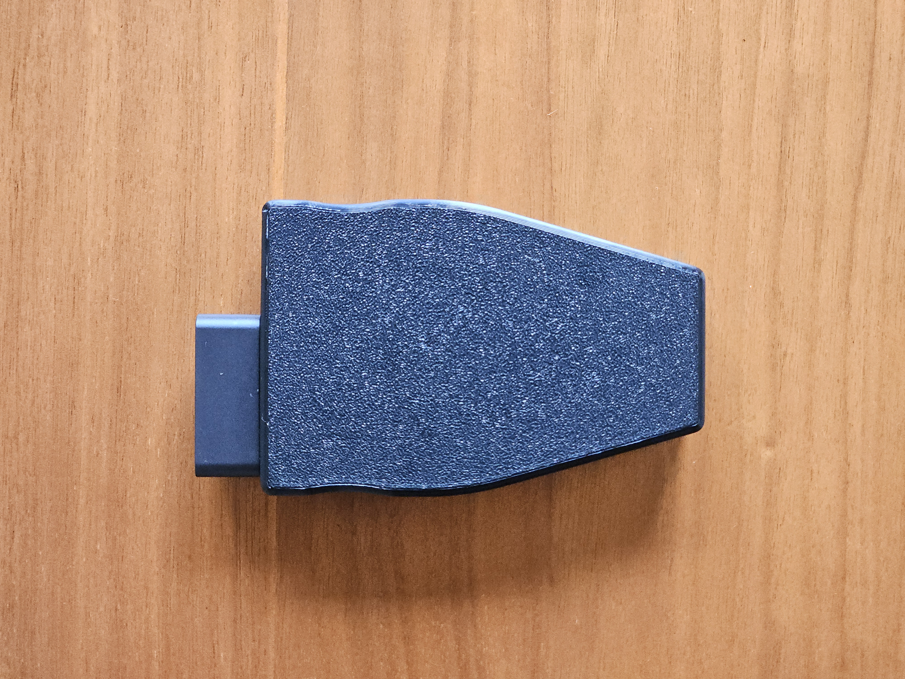
